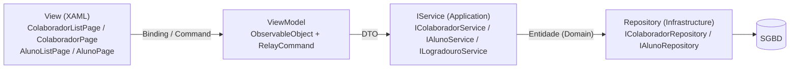

# AcademiaDoZe — Contexto e Requisitos: CRUD de Colaborador e Aluno

> Autor: Hibrael Andre Cidade Xavier · Disciplina: Desenvolvimento de Sistemas II (C#)
> Branch: `crud-colaborador-aluno` · Base: `main`
> Material de referência: `dev11de20.md` (PDF convertido da aula; snippets abaixo já limpos)

## 1. Objetivo

Parcial da Avaliação 02 (laboratório prático), na camada `AcademiaDoZe.Presentation.AppMaui`:

1. CRUD completo de **Colaborador**: listagem com filtros, cadastro, edição, exclusão e foto (galeria ou câmera).
2. CRUD completo de **Aluno**, no mesmo padrão.
3. **Identidade visual própria** (fundos ardósia, menu lateral escuro, paleta azul). Telas idênticas às do material não são aceitas.
4. **Dashboard com a logo da aplicação contendo o nome do autor.** Sem isso, o parcial é zerado.

### Entrega (recuperação)

| Turma | Prazo |
|---|---|
| 01 | 19/10 às 18:40 |
| 02 | 22/10 às 18:40 |

Postar no Classroom (3 itens): texto com o link do Git, zip da release do GitHub e vídeo de boa qualidade.

### Roteiro do vídeo (Colaborador e depois Aluno)

1. Cadastrar um novo registro com foto **tirada na hora** (câmera).
2. Na listagem, filtrar o registro pelo **CPF**.
3. Editar o registro filtrado: nome → **"zé dos testes"** e foto **trocada pela galeria**.
4. Buscar o registro editado na listagem e **excluí-lo**.

## 2. Checklist

### 2.1 Converters (`Converters/`)
- [x] `EnumDisplayConverter`
- [x] `DateOnlyToDateTimeConverter`
- [x] `FotoToImageSourceConverter`
- [x] `MascaraConverter` (extra: CPF, telefone e CEP formatados nos cards)
- [x] `Helpers/PessoaValidacao` (regras comuns de pessoa, espelhando os VOs) e `Helpers/FotoHelper` (galeria/câmera)

### 2.2 Colaborador
- [x] `ColaboradorListViewModel` (filtros Nome, CPF, Id, Email, Tipo, Vínculo; Add, Edit, Refresh, Search, Load, Delete; timeout de 5 s; FK)
- [x] `ColaboradorViewModel` (QueryProperty, Pickers, Initialize, Load, SearchByCpf, SearchByCep, Save, Cancel, SelecionarFoto, validação)
- [x] `ColaboradorListPage.xaml(.cs)` (DataTemplate, OnIdiom, RefreshView, EmptyView, FAB, ActivityIndicator)
- [x] `ColaboradorPage.xaml(.cs)` (CPF, Dados Pessoais + Foto, Endereço, Dados de Trabalho + Salário, ações)
- [x] `AppShell.xaml` (FlyoutItem `colaboradores`) e `AppShell.xaml.cs` (rota `colaborador`)
- [x] `MauiProgram.cs` (DI)

### 2.3 Aluno
- [x] `AlunoListViewModel` (filtros Nome via `ObterPorNomeAsync`, CPF, Id, Email)
- [x] `AlunoViewModel`
- [x] `AlunoListPage.xaml(.cs)`
- [x] `AlunoPage.xaml(.cs)`
- [x] Shell (`alunos` / `aluno`) e DI

### 2.4 Plataformas
- [x] Android: permissão `CAMERA`, `uses-feature` câmera (opcional) e `<queries>` com `IMAGE_CAPTURE` (sem isso, `IsCaptureSupported` é `false` no Android 11+)
- [x] iOS e MacCatalyst: `NSCameraUsageDescription`
- [x] Windows: o MAUI 10 tem implementação própria de `CameraCaptureUI` (abre uma janela de captura). App *unpackaged*: a câmera depende de Configurações > Privacidade > Câmera > "Permitir que aplicativos da área de trabalho acessem a câmera". `DeviceCapability webcam` declarada no `Package.appxmanifest` para o caso de empacotamento

### 2.5 Dashboard
- [x] Logo com o nome do autor visível e legível: ampliada via `OnIdiom` (Phone 200×143, Tablet 240×172, Desktop 260×186, TV 320×229)

### 2.6 Plataformas do vídeo
Windows (webcam), emulador Android e celular Android. O banco padrão é **SQLite local**, um arquivo por dispositivo, então cada plataforma tem seus próprios dados (cadastre o logradouro em cada uma). Com MySQL ou SQL Server, o servidor precisa ser alcançável pelo dispositivo: no emulador, `10.0.2.2` aponta para o PC; no celular, use o IP da máquina na rede.

### 2.7 Critérios de pronto
- [x] `dotnet build` sem erros e sem avisos (windows10.0.19041.0 e android: 0 avisos, 0 erros)
- [x] `dotnet test` passando (Domain.Tests 156/156, Infrastructure.Tests 60/60)
- [ ] Roteiro do vídeo executado de ponta a ponta (Colaborador e Aluno): **pendente, teste manual no app** (não automatizado)
- [x] Domain, Application e Infrastructure sem alterações
- [x] PR aberto para `main`

## 3. Material × Repositório (divergências e decisões)

| # | Tema | Material | Repositório (regra real) | Decisão |
|---|---|---|---|---|
| 1 | Senha (força) | mín. 6 caracteres + 1 maiúscula | VO `Senha`: mín. **8** caracteres, com **letra e número** | VM valida igual ao domínio |
| 2 | Senha na edição | "deixe em branco para manter a atual" | `Service.AtualizarAsync` → `ValidarSenha` lança *"Senha não pode ser vazia"*; o mapping exige `SENHA_OBRIGATORIA` e o UPDATE regrava a coluna | **Exigir a senha também na edição**, sem alterar a Application. A tela pede senha e confirmação e explica o motivo; no vídeo, redigitar a senha ao editar |
| 3 | Foto | opção "Remover Foto" | `FOTO_OBRIGATORIA` em Colaborador e Aluno | **Opção removida**: ActionSheet só com Galeria e Câmera; sem foto, a validação acusa "Foto é obrigatória" |
| 4 | Salário | não existe | `ColaboradorDto.Salario` é `required`; domínio exige `> 0` | **Entry numérico em R$**: aceita `2500`, `2500,50` ou `2.500,50` (pt-BR) e valida `> 0`; a listagem exibe em moeda pt-BR |
| 5 | `ArquivoDto.Nome` | não preenchido | VO `Arquivo`: só `.jpg/.jpeg/.png`, até 5 MB | `Nome = FileResult.FileName`; VM valida extensão e tamanho |
| 6 | Compressão | não existe | fotos de câmera podem passar de 5 MB | **Câmera comprimida** com `MediaPickerOptions` nativo do MAUI 10 (máx. 1024 px, JPEG 80%). **Galeria** (FilePicker) só validada: recusa extensão fora de .jpg/.jpeg/.png ou acima de 5 MB |
| 7 | Enums | exemplos "Administrador, Atendente, Instrutor" / "CLT, Estágio" | Tipo tem `AuxiliarDeLimpeza` ("Auxiliar de Limpeza"); Vínculo tem `PJ` e `Estagio` ("Estagiário") | mensagens de ajuda listam os valores reais via `GetDisplayName()` |
| 8 | Administrador ⇒ CLT | na VM | já existe no domínio (`ADMINISTRADOR_CLT_INVALIDO`) | replicado na VM |
| 9 | Idade mínima | 12 anos (Colaborador) | Colaborador 12, **Aluno 14** | VM replica cada uma |
| 10 | `DataDemissao` | não existe | somente leitura no DTO (`Colaborador.Desligar`) | não editável; exibida só se preenchida |
| 11 | E-mail | opcional | VO `Email` **obrigatório**; o Service também lança se vazio. Regex `^[^@.]+@[^@.]+.[^@.]+$` (sem ponto antes do `@`, um ponto no domínio) | obrigatório na VM, com a mesma regra do domínio |
| 12 | Telefone | exatamente 11 dígitos | VO aceita **10 ou 11** dígitos | VM aceita 10 ou 11 |
| 13 | CPF | só 11 dígitos | VO valida **dígitos verificadores** | VM valida os dígitos verificadores |
| 14 | Estilos | `CardBorder`, `ButtonPrimary`, `ButtonSecondary`, `ButtonSmall`, `ButtonDanger`, `SubHeadline`, `Gray500`, `Gray900`, `Secondary` | todos existem em `Resources/Styles`, mas com a identidade própria (cards 16 px de raio, botões pílula, ardósia). Há também `CampoBorda`, `Badge`, `TextoSecundario`, `RotuloMaiusculo`, `TituloCard`, `Icone` | reaproveitar os estilos da identidade, sem copiar cores fixas do material (avisos amarelos/verdes viram tons da paleta) |
| 15 | Logo da Dashboard | obrigatória com o nome | `academiadoze_*.svg` contém "ACADEMIA DO ZÉ" + "Hibrael Andre Cidade Xavier"; exibida a 130×93 px, o nome fica com ~7 px de altura | **Ampliar a logo** no cabeçalho da Dashboard via `OnIdiom` (desktop ~260×186), com a mesma arte |
| 16 | Nome (filtro Aluno) | filtra em memória | `IAlunoService.ObterPorNomeAsync` (contém, sem diferenciar maiúsculas) | usar o service |

## 4. Snippets limpos

### 4.1 Converters

```csharp
//Hibrael Andre Cidade Xavier
using AcademiaDoZe.Application.Enums;
using System.Globalization;

namespace AcademiaDoZe.Presentation.AppMaui.Converters;

// Converte qualquer Enum para o texto de [Display(Name)]
public sealed class EnumDisplayConverter : IValueConverter
{
    public object? Convert(object? value, Type targetType, object? parameter, CultureInfo culture)
        => value is Enum e ? e.GetDisplayName() : string.Empty;

    public object? ConvertBack(object? value, Type targetType, object? parameter, CultureInfo culture)
        => throw new NotSupportedException();
}
```

```csharp
//Hibrael Andre Cidade Xavier
using System.Globalization;

namespace AcademiaDoZe.Presentation.AppMaui.Converters;

// DateOnly (DTO) <-> DateTime (DatePicker)
public sealed class DateOnlyToDateTimeConverter : IValueConverter
{
    public object? Convert(object? value, Type targetType, object? parameter, CultureInfo culture)
        => value is DateOnly d ? d.ToDateTime(TimeOnly.MinValue) : DateTime.Today;

    public object? ConvertBack(object? value, Type targetType, object? parameter, CultureInfo culture)
        => value is DateTime dt ? DateOnly.FromDateTime(dt) : DateOnly.FromDateTime(DateTime.Today);
}
```

```csharp
//Hibrael Andre Cidade Xavier
using AcademiaDoZe.Application.DTOs;
using System.Globalization;

namespace AcademiaDoZe.Presentation.AppMaui.Converters;

// ArquivoDto (byte[]) -> ImageSource
public sealed class FotoToImageSourceConverter : IValueConverter
{
    public object? Convert(object? value, Type targetType, object? parameter, CultureInfo culture)
        => value is ArquivoDto { Conteudo.Length: > 0 } foto
            ? ImageSource.FromStream(() => new MemoryStream(foto.Conteudo))
            : null;

    public object? ConvertBack(object? value, Type targetType, object? parameter, CultureInfo culture)
        => throw new NotSupportedException();
}
```

### 4.2 DataTemplate com OnIdiom

```xml
<ContentPage.Resources>
    <converters:FotoToImageSourceConverter x:Key="FotoToImageSourceConverter"/>
    <converters:EnumDisplayConverter x:Key="EnumDisplay"/>

    <DataTemplate x:Key="ColaboradorItemTemplate" x:DataType="dto:ColaboradorDto">
        <Border Style="{StaticResource CardBorder}" Margin="6">
            <Grid ColumnDefinitions="Auto,*" ColumnSpacing="14">
                <Image Source="{Binding Foto, Converter={StaticResource FotoToImageSourceConverter}}" Aspect="AspectFill">
                    <Image.WidthRequest>
                        <OnIdiom x:TypeArguments="x:Double" Phone="72" Tablet="84" Desktop="84" TV="110" Default="72"/>
                    </Image.WidthRequest>
                    <Image.HeightRequest>
                        <OnIdiom x:TypeArguments="x:Double" Phone="72" Tablet="84" Desktop="84" TV="110" Default="72"/>
                    </Image.HeightRequest>
                </Image>
                <!-- dados... -->
            </Grid>
        </Border>
    </DataTemplate>
</ContentPage.Resources>

<CollectionView ItemsSource="{Binding Colaboradores}" ItemTemplate="{StaticResource ColaboradorItemTemplate}">
    <CollectionView.ItemsLayout>
        <GridItemsLayout Orientation="Vertical">
            <GridItemsLayout.Span>
                <OnIdiom x:TypeArguments="x:Int32" Phone="1" Tablet="2" Desktop="3" TV="4" Default="1"/>
            </GridItemsLayout.Span>
        </GridItemsLayout>
    </CollectionView.ItemsLayout>
</CollectionView>
```

### 4.3 Picker de enum com ItemDisplayBinding

```xml
<Picker ItemsSource="{Binding ColaboradorTipos}" SelectedItem="{Binding Colaborador.Tipo}"
        ItemDisplayBinding="{Binding ., Converter={StaticResource EnumDisplay}}"/>
```

### 4.4 SelecionarFotoAsync

```csharp
[RelayCommand]
private async Task SelecionarFotoAsync()
{
    var escolha = await Shell.Current.DisplayActionSheetAsync("Origem da foto", "Cancelar", null, "Galeria", "Câmera");

    FileResult? result = escolha switch
    {
        "Galeria" => await FilePicker.Default.PickAsync(new PickOptions
        {
            PickerTitle = "Selecione uma foto",
            FileTypes = FilePickerFileType.Images
        }),
        "Câmera" when MediaPicker.Default.IsCaptureSupported =>
            await MediaPicker.Default.CapturePhotoAsync(new MediaPickerOptions
            {
                MaximumWidth = 1024, MaximumHeight = 1024, CompressionQuality = 80
            }),
        _ => null
    };
    if (result is null) return;

    await using var stream = await result.OpenReadAsync();
    using var ms = new MemoryStream();
    await stream.CopyToAsync(ms);

    // valida extensão (.jpg/.jpeg/.png) e tamanho (<= 5 MB) como o VO Arquivo
    Colaborador.Foto = new ArquivoDto { Conteudo = ms.ToArray(), Nome = result.FileName };
    OnPropertyChanged(nameof(Colaborador));
}
```

### 4.5 Validação por lista de erros (Notification Pattern)

```csharp
var errors = new List<string>();
if (string.IsNullOrWhiteSpace(dto.Nome)) errors.Add("• Nome é obrigatório.");
if (!CpfValido(dto.Cpf))                errors.Add("• CPF inválido.");
// ... um item por regra do domínio ...
if (errors.Count > 0)
{
    await Shell.Current.DisplayAlertAsync("Erros de Validação",
        "Por favor, corrija os seguintes campos:\n\n" + string.Join("\n", errors), "OK");
    return false;
}
return true;
```

### 4.6 Permissões de plataforma

`Platforms/Android/AndroidManifest.xml`:

```xml
<uses-permission android:name="android.permission.CAMERA" />
```

`Platforms/iOS/Info.plist` e `Platforms/MacCatalyst/Info.plist`:

```xml
<key>NSCameraUsageDescription</key>
<string>A Academia do Zé usa a câmera para tirar a foto do cadastro.</string>
```

## 5. Rotas Shell e DI

| Rota | Tipo | Página | ViewModel |
|---|---|---|---|
| `//dashboard` | FlyoutItem | `DashboardListPage` | `DashboardListViewModel` |
| `//logradouros` | FlyoutItem | `LogradouroListPage` | `LogradouroListViewModel` |
| `logradouro?Id=` | RegisterRoute | `LogradouroPage` | `LogradouroViewModel` |
| `//colaboradores` | FlyoutItem (glyph `&#xea67;`) | `ColaboradorListPage` | `ColaboradorListViewModel` |
| `colaborador?Id=` | RegisterRoute | `ColaboradorPage` | `ColaboradorViewModel` |
| `//alunos` | FlyoutItem | `AlunoListPage` | `AlunoListViewModel` |
| `aluno?Id=` | RegisterRoute | `AlunoPage` | `AlunoViewModel` |
| `//configuracoes` | FlyoutItem | `ConfigPage` | — |

A Dashboard já navega para `//alunos` e `//colaboradores`.

`MauiProgram.cs`: `AddTransient` para `ColaboradorListViewModel`, `ColaboradorViewModel`, `AlunoListViewModel`, `AlunoViewModel`, `ColaboradorListPage`, `ColaboradorPage`, `AlunoListPage` e `AlunoPage`. `IColaboradorService`, `IAlunoService` e `ILogradouroService` já são registrados por `ConfigurationHelper.ConfigureServices`.

## 6. Arquitetura



A Presentation conhece só DTOs e enums `App*` da Application; não referencia o Domain.

## 7. Dicas para gravar o vídeo

| Etapa | Cuidado |
|---|---|
| Antes de começar | Tenha um **Logradouro** cadastrado (o CEP precisa existir em Logradouros). Libere a câmera: Windows (privacidade de apps da área de trabalho) e Android (aceite a permissão na primeira captura). Deixe uma foto `.jpg`/`.png` com até 5 MB na galeria ou em Imagens |
| Cadastro | Use um **CPF válido**: os dígitos verificadores são conferidos. E-mail **sem ponto antes do `@`** e com um único ponto no domínio (`zetestes@gmail.com`; `ze.testes@gmail.com` e `@empresa.com.br` são recusados pelo VO `Email`). Senha com **8+ caracteres, letras e números** (`Teste1234`). Colaborador: idade ≥ 12, Salário > 0 e, se Tipo = Administrador, Vínculo CLT. Aluno: idade ≥ 14 |
| Foto na hora | "Alterar foto" → **Câmera**. A imagem já volta comprimida (máx. 1024 px, JPEG 80%) |
| Filtro por CPF | Na listagem, filtro **CPF**, digite os 11 dígitos (com ou sem pontuação) e clique em **Buscar** |
| Edição | Botão de lápis → nome **"zé dos testes"** → "Alterar foto" → **Galeria** → **redigite a senha e a confirmação** (o Service exige a senha na edição) → Salvar |
| Exclusão | Filtro **Nome** "zé" (ignora acentos no Colaborador) ou CPF → lixeira → confirmar |

### Observação sobre o domínio (não alterado)
A regex do VO `Email` (`^[^@.]+@[^@.]+.[^@.]+$`) recusa e-mails comuns como `nome.sobrenome@x.com` e domínios `.com.br`. A VM replica a regra para avisar antes de salvar. Corrigir o VO exige mudança no Domain e fica para uma decisão futura.
